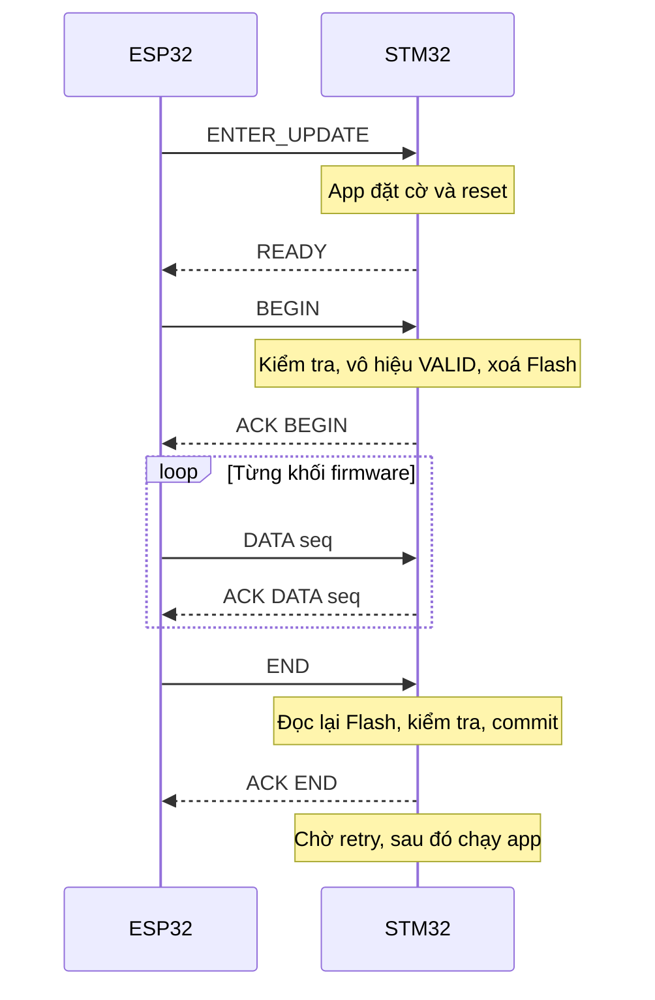

# Đặc tả OTA qua UART giữa ESP32 và STM32F103C8T6 — v1

> Code triển khai: `common/ota_frame/` (codec + layout dùng chung), `bootloader/`, `app/src/task_comm.c`,
> `bsp/bsp.c` (`bsp_reboot_to_bootloader`), `esp32/src/uart_bridge.cpp`. Quy trình kiểm tra: `docs/OTA_WORKFLOW.md`.

## 1. Phạm vi
ESP32 đã có file app.bin từ luồng nhận file qua Wi-Fi. STM32 có bootloader của nhóm ở đầu Flash và app điều khiển quạt
ở vùng Flash riêng. Bootloader nhận firmware, xác minh bản ghi trong Flash và chạy app mới.

V1: một vùng app, một phiên UART tại một thời điểm, stop-and-wait. Reset giữa lúc cập nhật thì nạp lại từ BEGIN.
CRC kiểm tra toàn vẹn dữ liệu (không phải xác thực). Hai đầu UART và file đầu vào do nhóm kiểm soát.

## 2. UART và biểu diễn
- 115200 baud, 8N1, 3,3 V, TX chéo RX, chung GND.
- STM32: USART1, PA9 TX, PA10 RX. App và bootloader cùng cấu hình. ESP32: Serial2, RX GPIO16, TX GPIO17 (`uart_bridge.cpp`).
- Log ngoài UART OTA (ESP32 log ra USB Serial; bootloader không log; app không gửi text trên USART1).
- Số nhiều byte: unsigned little-endian, ghép/tách từng byte.

### Khung chung hai chiều
```
[MAGIC A5 5A] [LEN u8] [BODY: LEN byte, byte đầu là TYPE] [CRC16 u16 LE trên LEN + BODY]
```
| Offset | Trường | Quy tắc |
|---|---|---|
| 0 | MAGIC | `A5 5A` |
| 2 | LEN | Số byte BODY (gồm TYPE), 1..131 |
| 3 | TYPE | Byte đầu của BODY |
| 4.. | Trường theo TYPE | Bảng mục 3 |
| 3+LEN | CRC16 | 2 byte LE, tính trên LEN và toàn bộ BODY |

Frame dài nhất 136 byte. Bộ nhận dò magic, kiểm tra LEN trước khi nhận BODY, nhận đủ BODY + CRC rồi kiểm CRC.
Trong BODY, `A5 5A` là dữ liệu bình thường. LEN sai, CRC sai, lỗi UART, hoặc quá **20 ms** giữa hai byte của frame
đang nhận → bỏ frame, dò magic lại. Sai CRC thì im lặng để phía gửi retry theo timeout.

### CRC
| Thông số | CRC-16/IBM-3740 (CCITT-FALSE) | CRC-32/ISO-HDLC |
|---|---|---|
| width | 16 | 32 |
| poly | 0x1021 | 0x04C11DB7 |
| init | 0xFFFF | 0xFFFFFFFF |
| refin/refout | false/false | true/true |
| xorout | 0x0000 | 0xFFFFFFFF |
| `"123456789"` | 0x29B1 (gửi `B1 29`) | 0xCBF43926 (gửi `26 39 F4 CB`) |

CRC-16 bảo vệ từng frame. CRC-32 trong BEGIN tính trên đúng file app.bin; khi END, STM32 tính lại từ đúng `size` byte trong Flash.

## 3. Lệnh và phản hồi
| TYPE | Mã | Chiều | BODY | LEN |
|---|---|---|---|---|
| ENTER_UPDATE | 0x01 | ESP32 → STM32 | TYPE | 1 |
| READY | 0x02 | STM32 → ESP32 | TYPE | 1 |
| BEGIN | 0x10 | ESP32 → STM32 | TYPE, size u32, image_crc32 u32 | 9 |
| DATA | 0x11 | ESP32 → STM32 | TYPE, seq u16, firmware_bytes[1..128] | 4–131 |
| END | 0x12 | ESP32 → STM32 | TYPE | 1 |
| ACK | 0x70 | STM32 → ESP32 | TYPE, acked_type u8, (+ seq u16 khi xác nhận DATA) | 2 hoặc 4 |
| NACK | 0x71 | STM32 → ESP32 | TYPE, rejected_type u8, error u8, seq u16 | 5 |

NACK: seq của frame DATA bị từ chối nếu đọc được, ngược lại 0xFFFF. READY là phản hồi thành công của ENTER_UPDATE.
ACK của lệnh khác hoặc khác seq bị bỏ qua khi đang chờ.

| Mã | Tên | Khi nào |
|---|---|---|
| 0x01 | BAD_STATE | Lệnh không được phép ở trạng thái hiện tại |
| 0x02 | BAD_LENGTH | CRC đúng nhưng bố trí BODY / độ dài DATA sai |
| 0x03 | BAD_IMAGE_SIZE | size ngoài vùng app hoặc < 8 byte |
| 0x04 | BAD_SEQ | Sai thứ tự, hoặc gói trùng khác nội dung |
| 0x05 | FLASH_ERROR | Xoá/ghi/đọc kiểm tra Flash lỗi |
| 0x06 | INCOMPLETE | END khi chưa đủ dữ liệu |
| 0x07 | IMAGE_CRC_ERROR | CRC-32 đọc lại từ Flash không khớp |
| 0x08 | BAD_VECTOR | Stack / reset vector ngoài phạm vi |
| 0x09 | UNSUPPORTED_TYPE | Mã lệnh không có trong v1 |

## 4. Flash layout (giá trị thực tế đang dùng)
F103C8: 64 KiB, page 1024 B, ghi half-word tại địa chỉ chẵn. Nguồn duy nhất trong code: `common/ota_frame/ota_layout.h`.

| Vùng | Bắt đầu | Kết thúc (loại trừ) | Kích thước |
|---|---|---|---|
| Bootloader | 0x08000000 | 0x08002000 | 8 KiB |
| App | 0x08002000 | 0x0800FC00 | 56 320 B |
| Metadata | 0x0800FC00 | 0x08010000 | 1 page |

Linker: `STM32F103C8Tx_FLASH.ld` + `keil/STM32F103C8.sct` (app), `bootloader/STM32F103C8_BOOT.ld` + `keil/Bootloader.sct`.
Bảng vector app là nội dung đầu tiên của app.bin. Bootloader vượt 8 KiB thì dời layout theo ranh giới page ở mọi file trên.

Metadata: `+0 size u32`, `+4 image_crc32 u32`, `+8 valid u16 = 0xA55A` khi đã commit.
BEGIN hợp lệ: xoá page metadata, kiểm marker = 0xFFFF, **rồi mới** xoá vùng app. END thành công: ghi + đọc lại size, crc,
cuối cùng ghi + đọc lại valid. Commit lỗi → về chế độ chờ nạp, cố ghi marker = 0x0000.
Mỗi lần khởi động: marker đúng, size trong giới hạn, vector hợp lệ, CRC-32 Flash khớp metadata mới chạy app.

## 5. Luồng STM32
### 5.1 App → bootloader
1. ESP32 gửi ENTER_UPDATE.
2. App nhận frame hợp lệ → handshake OTA_REQUEST/OFF_ACK (relay OFF) → `BKP_DR1 = 0xB007` → software reset.
3. Bootloader đọc và xoá cờ. Có cờ hoặc app không hợp lệ → WAIT_BEGIN; app hợp lệ và không cờ → chạy app.
4. UART sẵn sàng → gửi READY. READY mất: ENTER_UPDATE gửi lại trong WAIT_BEGIN nhận thêm READY, không xoá Flash.

BOOT0 giữ chế độ khởi động từ Flash chính.

### 5.2 WAIT_BEGIN → RECEIVING
- Chỉ ghi khi BEGIN đúng CRC, đúng LEN, `8 ≤ size ≤ APP_LIMIT - APP_BASE`.
- Vô hiệu metadata, xoá `ceil(size/1024)` page app, `next_seq = 0`, `written = 0`, rồi ACK(BEGIN).
- Đang RECEIVING, chưa có DATA nào, BEGIN trùng size + crc → chỉ ACK lại. BEGIN khác → BAD_STATE.
- Lỗi Flash → FLASH_ERROR, về WAIT_BEGIN.

### 5.3 RECEIVING — DATA
- Nhận gói mới khi `seq == next_seq`; độ dài phải bằng `min(128, size - written)` (= LEN − 3).
- `offset = seq × 128`, `address = APP_BASE + offset`, phải có `offset == written` và nằm trong vùng app.
- Gói cuối lẻ: đệm `FF` (byte cuối A5 → half-word 0xFFA5). written và CRC chỉ tính byte của file.
- Kiểm tra Flash + đọc lại rồi mới tăng written, next_seq và ACK(DATA, seq).
- `seq == next_seq − 1`: trùng nội dung → ACK lại, không ghi; khác → BAD_SEQ. Số khác → BAD_SEQ.
- Ghi lỗi giữa chừng → FLASH_ERROR, bắt đầu lại từ BEGIN.
- 15 s không có tiến triển (tính từ ACK gần nhất của BEGIN/DATA) → huỷ RAM, về WAIT_BEGIN.

### 5.4 END → COMPLETE_GRACE → app
1. Chưa đủ size → INCOMPLETE, giữ tiến độ.
2. CRC-32 từ Flash, kiểm vector, commit metadata. Sai → mã lỗi tương ứng, về WAIT_BEGIN.
3. ACK(END); sau khi byte cuối ra dây giữ COMPLETE_GRACE 2 s (tính từ ACK đầu tiên). END lặp lại → ACK lại; lệnh đổi Flash → BAD_STATE.
4. Hết cửa sổ → dọn ngoại vi, chạy app.

Vector: word tại APP_BASE là MSP căn 8, `0x20000000 < MSP ≤ 0x20005000`; word tại APP_BASE+4 có bit Thumb và nằm trong ảnh.
Nhảy app: tắt SysTick, IRQ bootloader đã bật, VTOR = APP_BASE, MSP, rồi Reset_Handler.

## 6. ESP32: timeout và retry
| Chờ sau khi gửi hết frame | Timeout | Thành công khi nhận |
|---|---|---|
| ENTER_UPDATE | 1000 ms | READY |
| BEGIN | 3000 ms | ACK(BEGIN) |
| DATA | 100 ms | ACK(DATA, seq) đúng số |
| END | 500 ms | ACK(END) |

- 1 lần gửi + tối đa 3 lần gửi lại nguyên frame. Chỉ chuyển bước khi đúng loại và đúng seq. ACK cũ không reset bộ đếm.
- NACK đúng lệnh đang chờ → kết thúc, báo mã lỗi (DATA: seq trùng hoặc 0xFFFF).
- Truyền trọn một frame rồi chờ, kể cả khi STM32 đang xoá/ghi. Frame 136 B ở 115200 ≈ 11,8 ms.
  Ghi 64 half-word ≈ 4,48 ms; xoá tối đa 40 ms/page. Đo thực tế với ảnh lớn nhất và chỉnh timeout nếu cần.
- Hết lượt END không có ACK → "chưa xác nhận được kết quả". Có ACK(END) → firmware đã qua kiểm tra và commit.



## 7. Byte mẫu (đã kiểm trong `tests/host/test_ota.c`)
| Trường hợp | Frame hex |
|---|---|
| ENTER_UPDATE | `A5 5A 01 01 1F 3E` |
| READY | `A5 5A 01 02 7C 0E` |
| BEGIN size 1000, CRC 0xCBF43926 | `A5 5A 09 10 E8 03 00 00 26 39 F4 CB 69 DD` |
| DATA số 5, payload 11 22 33 | `A5 5A 06 11 05 00 11 22 33 7F 3E` |
| ACK DATA số 5 | `A5 5A 04 70 11 05 00 D9 51` |
| END | `A5 5A 01 12 4D 1C` |
| ACK END | `A5 5A 02 70 12 D6 98` |
| NACK BEGIN BAD_IMAGE_SIZE | `A5 5A 05 71 10 03 FF FF 3E A5` |

## 8. Ghi chú triển khai (bổ sung / làm rõ so với bản đặc tả gốc)
- **ENTER_UPDATE khi đang RECEIVING**: bootloader huỷ phiên RAM, về WAIT_BEGIN và trả READY (VALID vẫn thiếu nên an toàn),
  để ESP32 nạp lại ngay thay vì chờ hết 15 s. Trong COMPLETE_GRACE vẫn trả BAD_STATE.
- READY / ACK / NACK gửi tới STM32 (sai chiều) → NACK BAD_STATE. TYPE lạ → UNSUPPORTED_TYPE.
- DATA thừa sau khi đã đủ size → BAD_SEQ.
- Cờ BKP_DR1 = 0xB007 (`OTA_BKP_FLAG_UPDATE`). Blue Pill nối VBAT với 3,3 V nên mất điện là cờ mất (đúng ý muốn).
- App chưa có TaskControl: TaskComm vẫn set OTA_REQUEST, rồi `bsp_reboot_to_bootloader()` tự ép relay OFF trước khi reset.
  Bootloader cũng giữ PB8 ở mức OFF suốt thời gian chạy.
- Nạp app lần đầu bằng ST-Link cần thêm metadata: `make flash` tự tạo `meta.bin` bằng `tools/make_meta.py`.
- Khởi động thường: bootloader tính CRC-32 toàn ảnh (bitwise, HSI 8 MHz) trước khi chạy app, ảnh 55 KiB mất khoảng 0,3 s.
